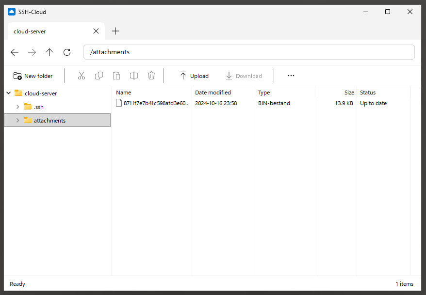

# SSH-Cloud

The ultimate simple cloud storage client. As simple as it gets.

Your cloud is any server you can SSH into. No sync engine, no daemon, no
database, no vendor. Just a Windows window on a folder on your server.



- **Browse** the server like Windows Explorer: rename, move, copy and delete
  happen directly on the server.
- **Look at a file:** double-click it to open a read-only copy with its
  default application.
- **Work on a file:** drag it out, edit it, drag it back.
- **Never lose work:** if someone changed the file in the meantime, or you
  upload a different file with the same name, SSH-Cloud asks before it
  overwrites. No locks, no conflicts hidden from you.
- **Nothing to install on the server:** plain OpenSSH (SFTP) is all it needs,
  and it keeps nothing there but your files.
- **Feels like home:** a Windows 11 style window with tabs for several
  connections, light or dark like the rest of Windows.

## Get started

You need to be on Windows 11. Install the MSI from the
[releases](https://github.com/mevdschee/ssh-cloud/releases). It installs for
your user only and does not need admin rights. Run SSH-Cloud from
the Start menu, enter your server, username and remote folder, and you have a
cloud. Log in with your SSH agent, Pageant, a key file or a password. Use "Check
for updates" in the "..." menu to get new versions.

Versions before v0.3 kept a hidden `.<name>.sha256` file next to every file.
They are no longer used. SSH-Cloud still hides them and removes them when it
deletes or moves a file. To remove them all at once, run this on the server:

```
find /path/to/folder -name '.*.sha256' -delete
```

## Build

```
go install github.com/tc-hib/go-winres@latest
go test ./...            # runs on Linux, except for dragging files out
./run.sh                 # build ssh-cloud.exe and run it with Wine
./release.sh [minor]     # build the MSI and publish a GitHub release
```

## Why? Other tools

There are great open source tools for files on a SFTP server. SSH-Cloud exists
because none of them is as simple and easy to use and learn.

- **File transfer clients:** [WinSCP](https://winscp.net),
  [FileZilla](https://filezilla-project.org) and
  [Cyberduck](https://cyberduck.io): powerful clients with many protocols,
  two-pane views, sync and scripting.
- **Drive mounts:** [SSHFS-Win](https://github.com/winfsp/sshfs-win) and
  [rclone mount](https://rclone.org/commands/rclone_mount/) make the server look
  like a local drive that every application can use directly.
- **Sync tools:** [rclone](https://rclone.org) and
  [Syncthing](https://syncthing.net) keep copies in sync on several machines.
- **Self-hosted cloud suites:** [Nextcloud](https://nextcloud.com) and
  [Seafile](https://www.seafile.com) give you a complete cloud with their own
  server software.
- **SSH clients with a file browser:**
  [electerm](https://github.com/electerm/electerm) and
  [Muon SSH](https://github.com/devlinx9/muon-ssh) combine a terminal with SFTP.

Any of these projects has more features and a more complicated user interface.

## To do

SSH-Cloud works, but has seen little testing outside of the happy path. Things
that still need to be tested properly:

- **Many files:** folders with thousands of files and deep folder trees, both
  for browsing and for copying, moving and deleting.
- **Large files:** uploads and downloads of several gigabytes, progress
  reporting, cancelling halfway and running out of disk space on either side.
- **Failure modes:** the connection dropping during a transfer, the server
  restarting, permission denied, files locked or open in another application,
  changed host keys, wrong or expired credentials and slow connections.
- **Display scaling:** different DPI settings (100%, 125%, 150%, 200%) and
  moving the window between monitors with different scaling.
- **Translations:** currently available in English only, needs other languages
  as well, such as Dutch, Spanish and French.
- **SSH servers:** only tested against OpenSSH on Debian 13. Other OpenSSH
  versions, other distributions, macOS, Windows OpenSSH, Dropbear and SFTP-only
  hosting (chrooted accounts, NAS devices) still need testing.

## License

MIT. Icons from
[Fluent UI System Icons](https://github.com/microsoft/fluentui-system-icons)
(MIT).
